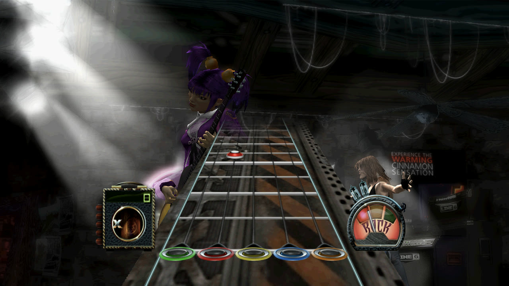
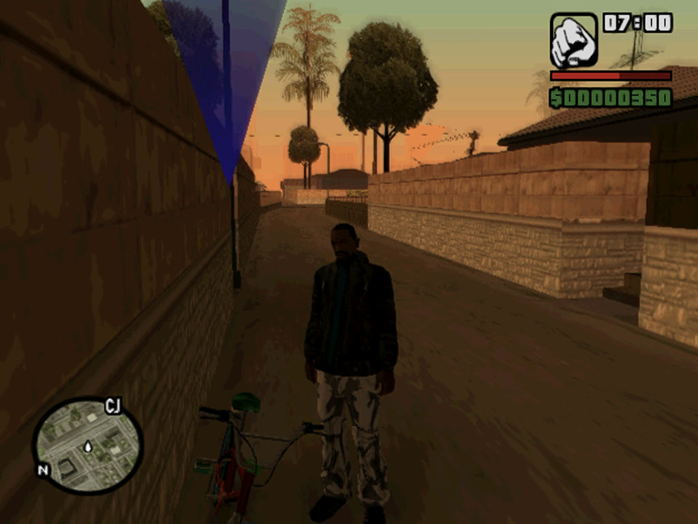
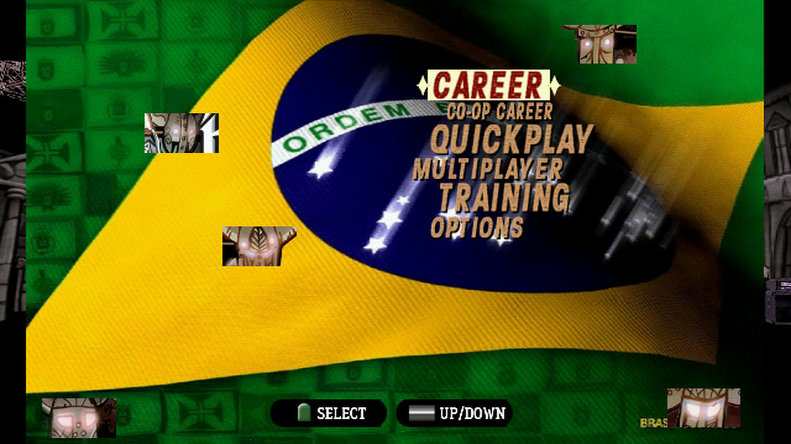
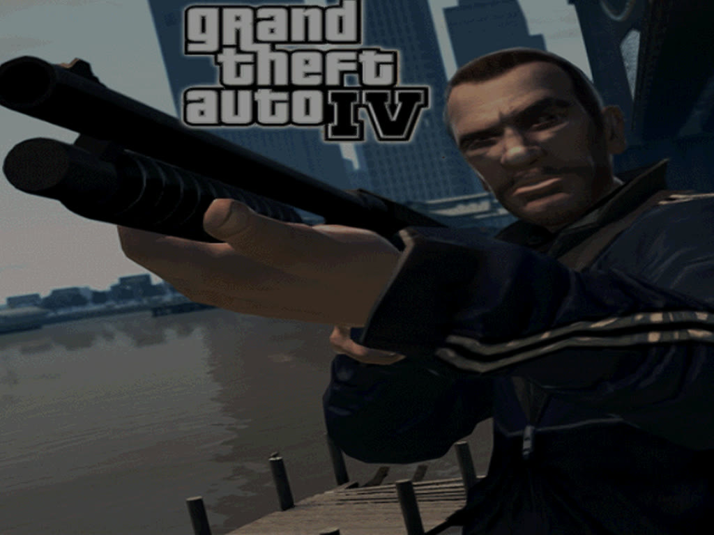

# ps2-native for Mac

Play your own PlayStation 2 games natively on Apple silicon Macs. One script turns your disc into a Mac app that you open
from Finder.

It is not an emulator: the code of the PS2's main processor is recompiled ahead of time into native arm64 code, and the rest
of the console (graphics, sound, the second processor) is rebuilt around it, with the graphics drawn on Metal. Nothing from
any game is in this repository, and the project is not affiliated with Sony or any game publisher.

[Games](#games) · [Requirements](#requirements) · [How to play](#how-to-play) · [Controls and settings](#controls-and-settings) · [When a game does not work](#when-a-game-does-not-work) · [For developers](#for-developers) · [Credits](#credits-and-license)

<p align="center">
  
  
</p>

## Games

| | Game | How far | Page |
|---|---|---|---|
|  | **Guitar Hero III: Legends of Rock** | Plays songs, with sound and notes in time. 16:9 patch, AMD FSR 1 up to 4K, the keyboard held like a guitar. | [Guitar Hero III](docs/games/guitar-hero-3.md) |
|  | **Grand Theft Auto: San Andreas** (a "GTA IV" mod disc) | Boots into the game in Jefferson at 60 fps. Driving, missions and saves are not tried yet. | [GTA San Andreas](docs/games/gta-san-andreas.md) |

Upstream (Windows and Linux) has tested more than 45 games, among them God of War, Gran Turismo 4, Resident Evil 4, Silent
Hill 2, Shadow of the Colossus and GTA III: [the upstream list](docs/upstream.md#what-runs). The same script builds them on
the Mac too, without a profile; they are not tried on the Mac yet. Tell me how they run (see [below](#when-a-game-does-not-work)).

## Requirements

- **A Mac with Apple silicon** (M1 or later). Tested on an M5 Pro with macOS 27; other Apple silicon Macs should work.
- **Xcode's command line tools** and **[Homebrew](https://brew.sh)**.
- **Your own disc**, as an image: `.iso`, or `.bin`/`.cue`, `.zip`, `.7z`. Making the image is up to you; this project has no
  copy-protection code (PS2 discs need none) and does not help find games.
- About 2 GB free per game for the build. The app holds a copy of the disc image, which costs no space on the same drive
  (an APFS clone).

## How to play

**1. Install the tools** (only once), in Terminal:

```bash
xcode-select --install
```

```bash
brew install cmake ninja pkg-config sdl2 ffmpeg ccache bash
```

```bash
git clone https://github.com/vinifloriano/ps2-native.git && cd ps2-native
```

**2. Build the app** from your disc image:

```bash
bash scripts/build_mac_app.sh ~/Games/GuitarHero3.iso
```

It shows each step and puts the app in `/Applications`. Here with the GTA disc:

```
$ bash scripts/build_mac_app.sh ~/Games/GTA-IV-mod.iso

==> 1/5  Checking the tools
    all there (Homebrew bash: /opt/homebrew/bin/bash)

==> 2/5  Reading the disc
    volume GTA IV, boots SLUS_786.45
    profile: GTA IV San Andreas (docs/apple/profiles/SLUS_786.45.conf)

==> 3/5  Translating the game's code to arm64 (the first time takes 5 to 20 minutes)
    machine code to C++
    playing it for a while to find code the first pass missed
      round 1: missing code at 0x0088D900 (ra 0x00242BCC), 1 new entry points, 1 new window images
      round 2: frame limit reached, 0 new entry points, 1 new window images
    compiling
    done in 15 min

==> 4/5  Picking an icon
==> 5/5  Packing the app

✓ GTA IV San Andreas is ready
    open it from Finder (Applications), or: open "/Applications/GTA IV San Andreas.app"
```

**3. Play:** open the app from Finder. The first minute of a game can stutter while code the build did not see is
translated; it is kept for the next start.

| Option | What it does |
|---|---|
| `--title "Name"` | the app's name (default: from the game's profile, or the disc's name) |
| `--icon picture.png` | the app's icon (default: a picture the game showed while it was being built) |
| `--out ~/Games` | where the app goes (default: `/Applications`) |
| `--4x3` | leave out a game's widescreen patch |
| `--quick` | rebuild a game built before without playing it again, after `git pull` for example (a minute or two) |

Games with a **profile** ([docs/apple/profiles](docs/apple/profiles/README.md)) get their settings by themselves: keys,
patches such as 16:9, and how long to explore.

## Controls and settings

- **F1** shows every key and opens the menu: quick save and load, resolution, full screen, changing keys.
- Keyboard: **W A S D** is the left stick, **Space**, **E**, **Q**, **F**, **Shift** and the mouse buttons are the game's
  buttons, **Esc** is Start. A game's own page lists better keys for it (Guitar Hero III plays on **A S D F G** and the arrows).
- **A game controller** works without setup (PlayStation, Xbox and any controller macOS knows).
- **F5 / F8** quick save and load · **F11** full screen · **F2** picture style, including **AMD FSR 1** up to 4K.

Settings live in `keys.ini` in the game's folder, `~/Library/Application Support/ps2-native/<game>/` (it also holds the
memory card, quick saves and the last run's `log.txt`):

| Line | What it does |
|---|---|
| `look = fsr` | AMD FSR 1: the picture is enlarged to the window (4K in full screen on a 4K display) and sharpened; F2 goes through the other looks |
| `scale = 2` | the inner resolution, 1 to 3 times the PS2's (2 keeps 60 fps on an M5 Pro in Guitar Hero III) |
| `audio_latency = 30` | milliseconds of sound waiting for the speakers, 20 to 200 (about 80 without it): less is heard sooner |

## When a game does not work

- The build's whole output is in `games/<game>/build.log`, and the last play's in
  `~/Library/Application Support/ps2-native/<game>/log.txt`.
- A game that stops while being built ("missing code" in the last rounds) often needs longer exploring: give it a profile
  with `port_options = --rounds 20 --frames 15000` ([how](docs/apple/profiles/README.md)).
- Please [open an issue](https://github.com/vinifloriano/ps2-native/issues) with the game's name, its boot file (the
  script prints it) and both logs. Never attach the disc image or files from it.

## For developers

[The plan for Apple platforms](docs/apple/plan.md) · [Guitar Hero III notes](docs/apple/gh3-bakeoff.md) ·
[GTA San Andreas notes](docs/apple/gtasa.md) · [How the recompiler works](docs/upstream.md#how-it-works) ·
[Game profiles](docs/apple/profiles/README.md) · [The upstream README](docs/upstream.md)

- `scripts/build_mac_app.sh` runs `scripts/port.sh` (translate, explore, build) and `scripts/mac_app.sh` (pack the app);
  both can be used on their own, with more options.
- Tests: `.github/workflows/ci.yml` lists them; most need no game.
- Fixes go into the recompiler and the runtime, never into one game's code, so they help every game. This fork's fixes
  are written to go back upstream.

## Credits and license

- **[ps2-native-recomp](https://github.com/exoteric33/ps2-native-recomp)** by exoteric33 (MIT), which this is a fork of,
  with its history. It started as **[ps2-web-recomp](https://github.com/snuri00/ps2-web-recomp)** by Samir Nuri (MIT).
  Its README, with the games it has tested and how it all works, is in [docs/upstream.md](docs/upstream.md).
- **[nxnative](https://github.com/seedds/nxnative)**: the idea of one script from your game to an app, and this README's
  shape.
- **AMD FidelityFX Super Resolution 1.0** (MIT, notice in [docs/apple/fsr1-license.txt](docs/apple/fsr1-license.txt)).
- The MPEG decoder's VLC tables come from **[Play!](https://github.com/jpd002/Play-)** (BSD 2-clause, `runtime/src/ipu/NOTICE`).
- **[PCSX2](https://github.com/PCSX2/pcsx2)** and its community patches are a reference; patch files are downloaded only
  when you ask for them, never shipped.

MIT, see [LICENSE](LICENSE). Much of the code was written with an AI coding assistant (Claude Code) and checked with the
test suite and real discs.

This repository holds no game code or data: no disc images, extracted files, generated C++, built programs or saves. The
generated code and the apps are translations of your game: keep them on your Mac and do not share them. The screenshots in
`docs/images` show what works.

PlayStation and PS2 are trademarks of Sony Interactive Entertainment. Game names are trademarks of their owners.
