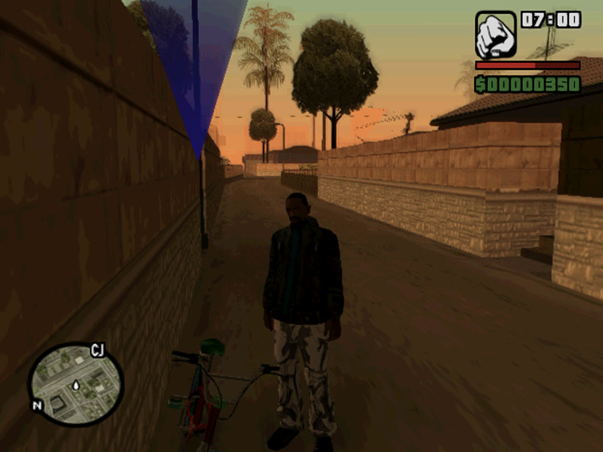
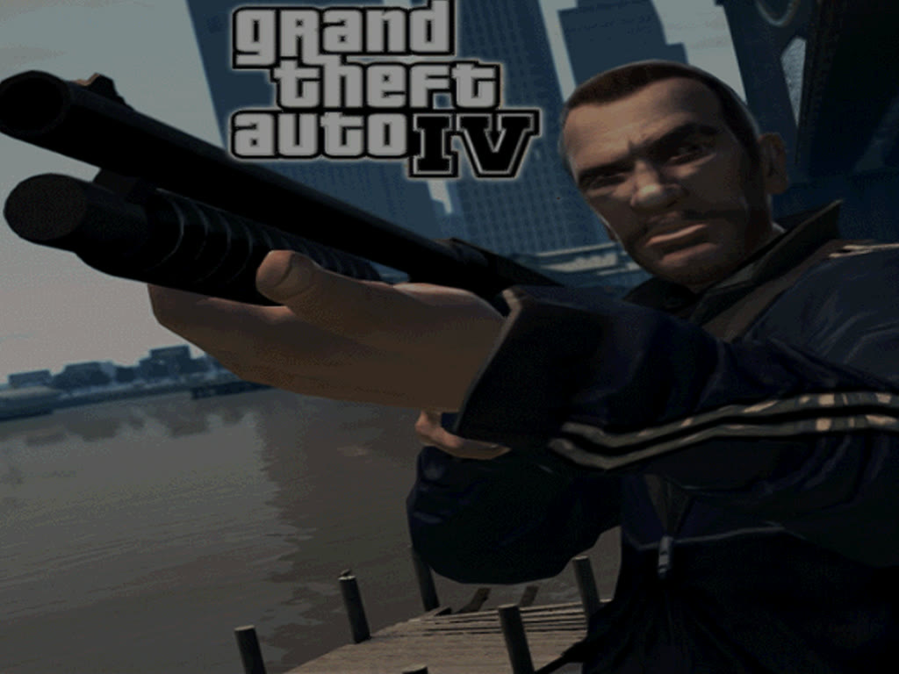

# Grand Theft Auto: San Andreas ("GTA IV" mod disc)

Boot file `SLUS_786.45`: San Andreas for the PS2, version 1.03, with a Brazilian "GTA IV" mod (its own loading screens,
opening film and Portuguese text).

<p align="center">
  
  
</p>

## Build

```bash
bash scripts/build_mac_app.sh ~/Games/GTA-IV-mod.iso
```

The profile ([SLUS_786.45.conf](../apple/profiles/SLUS_786.45.conf)) gives it longer exploring (20 runs of about four
minutes, around 15 minutes on an M5 Pro) and the 121 start-up functions that only a table reaches.

## Play

- **W A S D** move Carl, the mouse buttons, **Space**, **E**, **Q**, **F** and **Shift** are the PS2 buttons (**F1** shows which
  is which), **Esc** is Start.
- A game controller works too (not tried with this game yet).

## What works

- From power-on through the Rockstar logos, the mod's opening film and loading screens, into the game: Carl in Jefferson with
  the HUD (clock, money, radar, the area's name) and the hints in Portuguese, at 60 fps in a window.
- A 15,000-frame run (over four minutes) with no stop: the game's clock went from 06:43 to 09:27.

## Not checked yet

- Walking around, driving, missions, saving to the memory card, the sound by ear.
- The film decoder reports one bad code in the opening film.
- Other San Andreas discs, such as the retail one (boot file `SLUS_209.46`): not tried. The script builds them without a profile.

## Notes

The game loads eight code overlays (`.NM` files) into one place in memory. Four fixes to the recompiler made that work, and
they help any game that does the same: [docs/apple/gtasa.md](../apple/gtasa.md).
