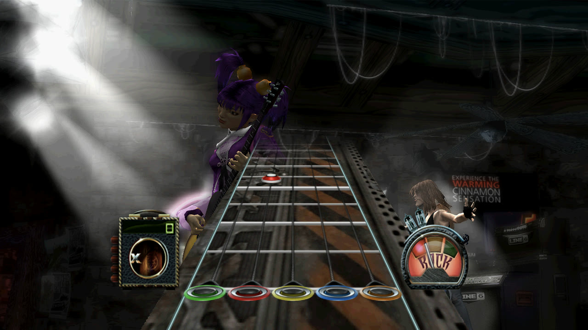
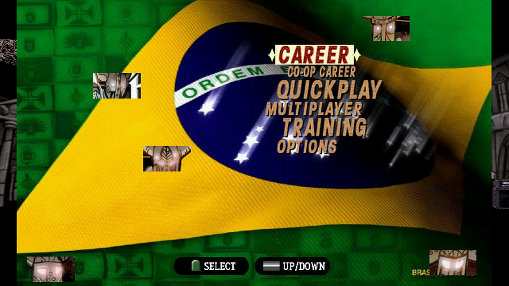
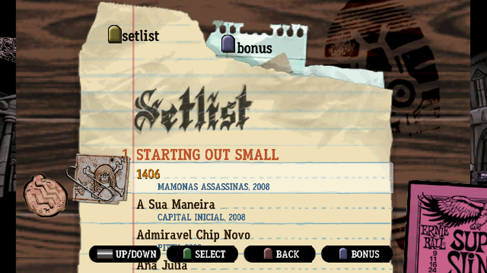

# Guitar Hero III: Legends of Rock

Boot file `SLUS_216.72` (NTSC-U). The Brazilian "Brazucas" disc keeps this executable and works the same.

<p align="center">
  
</p>
<p align="center">
  
  
</p>

## Build

```bash
bash scripts/build_mac_app.sh ~/Games/GuitarHero3.iso
```

The profile ([SLUS_216.72.conf](../apple/profiles/SLUS_216.72.conf)) sets up everything below by itself: the 16:9 patch, the
guitar keys, FSR at 2× and 30 ms sound. `--4x3` builds it without the 16:9 patch.

## Play

The keyboard is held like a guitar: the left hand on the frets, the right hand strums.

| | Keyboard | Controller |
|---|---|---|
| Frets green, red, yellow, blue, orange | **A S D F G** (or 1 to 5) | L2, L1, R1, R2, Cross |
| Strum, menus | **↑** / **↓** (or Enter) | D-pad |
| Star power | **Space** | Select |
| Pause | **Esc** | Start |
| Back in menus | **Backspace** | Circle |

With a normal controller GH3 plays a note when you press its fret: holding the fret and strumming is not needed.

## What works

- From power-on through the menus, Quickplay, the difficulty and setlist screens into a song: the highway, notes, star power,
  the band and the crowd, with the song's sound.
- **16:9**: a wider stage with the band and highway in shape, the HUD and menus kept 4:3 in the middle
  ([the patch](../apple/gh3-widescreen.pnach)).
- **AMD FSR 1** up to 4K in full screen, 60 fps at 2× resolution on an M5 Pro (3× does not keep 60 fps).
- Clearer songs (the 33 kHz streams are resampled with a windowed sinc) and 30 ms of sound delay instead of about 80.

## Not checked yet

- A whole song played by hand, and the results screen.
- Saving to the memory card (the runs so far only read it).
- Career and multiplayer screens in 16:9.
- A USB guitar (whammy, tilt).

## Notes

- Held notes glow green on every fret: that is the game's own look on PS2 too (checked against a PCSX2 recording of this disc).
- The window title still says "ps2-native-recomp".
- What it took, step by step: [docs/apple/gh3-bakeoff.md](../apple/gh3-bakeoff.md).
